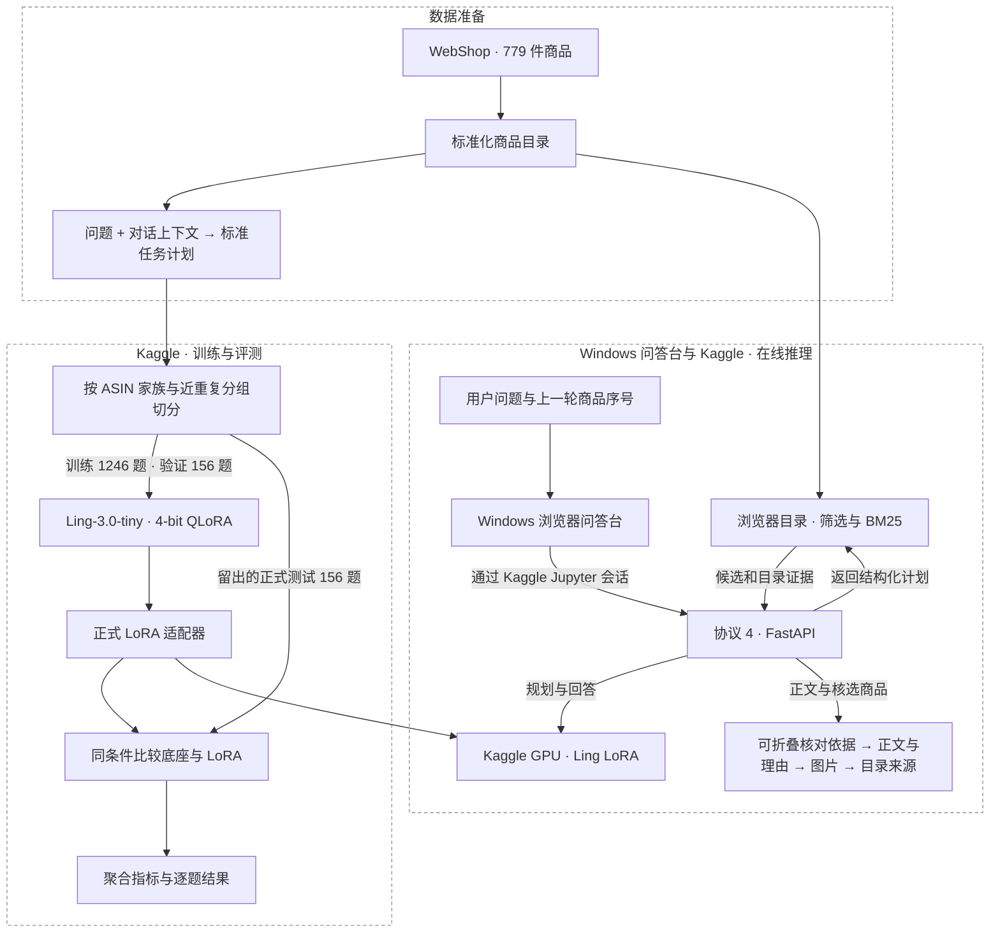
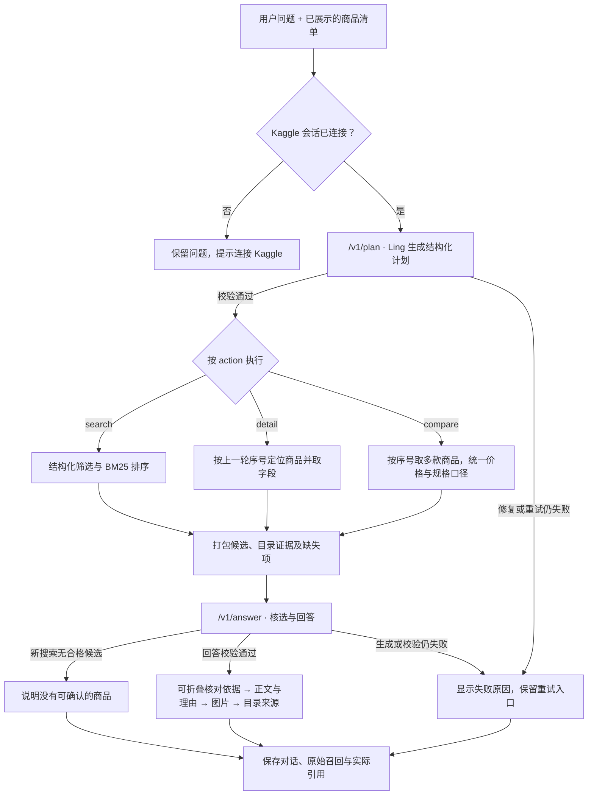

# WebShop RAG · 电商商品问答工作台

WebShop 是一个 Windows 商品问答台。你可以按预算、尺码、颜色等条件选购，也可以按上一轮的商品序号追问。问答台从 779 件商品中检索目录证据，Kaggle 上的 Ling-3.0-tiny LoRA 负责理解问题、核选商品和生成回答。

[](https://huggingface.co/inclusionAI/Ling-3.0-tiny)
[](RECIPE.md)
[](training/serve.py)
[](https://www.kaggle.com/code/aaronyue77/webshop-ling-inference)

[打开 Kaggle 一键推理](https://www.kaggle.com/code/aaronyue77/webshop-ling-inference) · [下载 Windows 问答台](https://github.com/AaronYue77/webshop-ling-rag/archive/refs/heads/main.zip)

[快速开始](#快速开始) · [问答示例](#问答示例) · [系统架构](#系统架构) · [问答流程](#问答流程) · [实测结果](#实测结果) · [训练与评测](RECIPE.md)


## 快速开始

### 1. 打开 Windows 问答台

下载并解压源码 ZIP 后，双击 `启动问答.cmd`。

问答台会在浏览器打开，可以浏览商品、继续之前的对话，也可右键导出单条对话。提问需要连接 Kaggle。直接打开 `WebShop.html` 可浏览商品目录和 Kaggle 图文说明。对话记录的位置见[日志说明](LOGS.md)。

### 2. 连接 Kaggle 模型

打开 [Kaggle 一键推理 Notebook](https://www.kaggle.com/code/aaronyue77/webshop-ling-inference)，点 **Copy & Edit**，在 **Settings** 启用 GPU 和 Internet，再点 **Run All**。看到 **WebShop LoRA 已就绪** 后，从 **Run → Kaggle Jupyter Server** 复制 **VSCode Compatible URL** 并粘贴到问答台。问答期间保持会话运行。问答台与 Notebook 需使用同版本，旧副本可从[仓库版推理 Notebook](kaggle/webshop-ling-inference.ipynb)重新导入。

### 3. 复现训练与评测

使用[训练与评测指南](RECIPE.md)复现 QLoRA 训练和基座、LoRA 的正式测试。

本地回归可在项目根目录运行。

```bash
node --test tests/rag.test.cjs
python -m unittest discover -s tests -p "test_*.py"
```

## 问答示例

> 我想给女朋友买一双 8.5 码的女士鞋，预算 50 美元以内。请给我图片、历史价格和推荐理由，并列出颜色与尺码信息。

示例按女士鞋、US 8.5 码和单件预算不超过 50 美元筛选。以下是目录中对应的四条记录。逐款推荐理由写在回答框，图片卡旁可查看颜色和尺码。点回答框上方的三角按钮可查看查找与核对依据。

| 商品 ASIN | 目录快照价 | 选项表尺码 |
|---|---:|---|
| `B09S3TWKSC` | $6.99 | 8.5 |
| `B09RPRRNVP` | $15.99 | 8.5 |
| `B09QL82H1L` | $23.29 | 8.5 |
| `B09QKJHF4Q` | $37.99 | 8.5 |

目录只保存了未标明采集日期的价格快照，因此页面会说明缺少历史价格序列。按表中顺序追问「第一款和第三款差多少钱？」，第一款的目录快照价低 16.30 美元。也可以追问颜色、材质、尺码标价或配件兼容性。

## 系统架构



[查看启动连接、问答执行和训练评测架构](docs/ARCHITECTURE.md)。

## 问答流程



| 能力 | 实现 |
|---|---|
| 任务规划 | Kaggle 上的 Ling 识别检索、详情、对比和资料需求，给出材质、规格等必要条件和排除条件。浏览器校验计划并执行。[规划协议](web/policy.js) · [计划与执行](web/rag.js) |
| 商品检索 | 在 779 条目录记录上使用 BM25、结构化筛选和预算判断。详情和对比可按上一轮商品序号定位。[检索与证据](web/rag.js) |
| 证据核对 | 分开检查目录价格、独立尺码价、颜色、库存记录和兼容线索。遇到资料不足时，说明缺失项并继续回答其他问题。[检索与证据](web/rag.js) |
| 网页与推理服务 | 连接 Kaggle 后，页面把问题和目录证据交给 Ling。新搜索只展示模型核选的商品，详情和比较保留用户指明的商品。[网页交互](web/app.js) · [FastAPI 服务](training/serve.py) |

[详细问答执行图](docs/ARCHITECTURE.md#问答执行) · [输入与回答格式](docs/ANSWER-FORMAT.md)

## 实测结果

基座与 LoRA 使用相同的模型版本、生成设置和 156 道留出测试题，共生成 312 条结构化任务计划。

| 指标 | 正式测试 156 题（底座 → LoRA） |
|---|---:|
| 有效 JSON | 55.77% → 98.72% |
| 任务宏 F1 | 29.58% → 90.04% |
| 约束完全匹配 | 55.13% → 96.15% |
| 完整计划匹配 | 0% → 76.92% |

[查看正式测试报告](docs/results/test/per-question.md)，可查每题的评分、标准计划和两种模型输出，以及完整题目与汇总数据。

## 仓库目录

| 目录 | 入口 |
|---|---|
| [web/](web/) | Windows 页面、目录索引、任务规划与检索 |
| [training/](training/) | 4-bit QLoRA、对照评测、FastAPI 和训练配置 |
| [kaggle/](kaggle/) | 训练、评测和推理 Notebook |
| [data/sft/](data/sft/) | ASIN 分组、结构化计划样本与数据清单 |
| [docs/](docs/) | 架构、评测与运行说明 |
| [tests/](tests/) · [scripts/](scripts/) | 回归测试、数据处理、Notebook 与单页生成 |

[WebShop 数据来源](https://github.com/princeton-nlp/WebShop)
