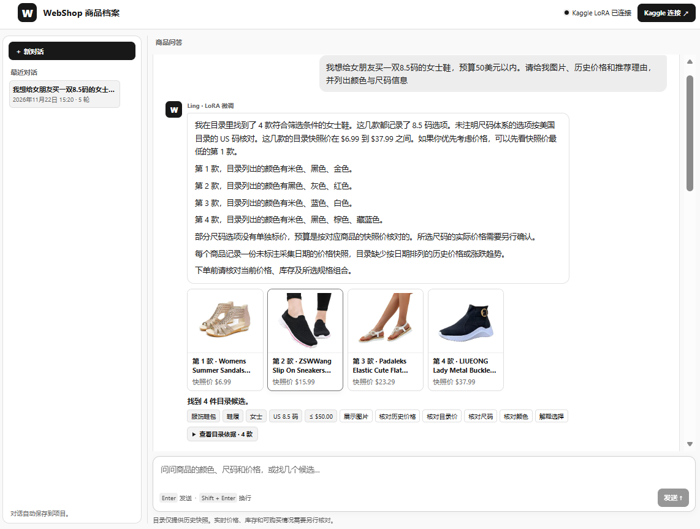
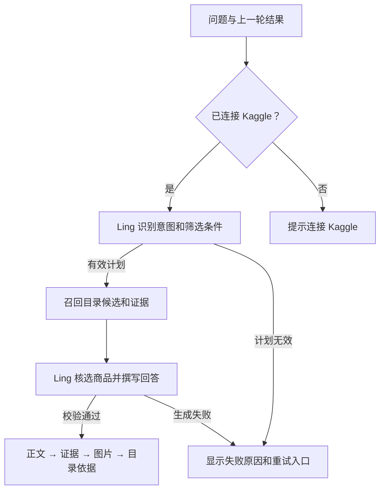

# WebShop RAG · 电商商品问答工作台

**购物问题常常同时涉及预算、尺码、颜色和选购理由。WebShop 在 Kaggle 上用微调后的 Ling-3.0-tiny 理解问题。问答台从 779 件商品中召回候选及其目录证据，Ling 再按原问题核选商品并生成连贯的回答。用户可以按展示的商品序号追问，目录缺少的资料会在回答中标明。**

Ling-3.0-tiny QLoRA × FastAPI × BM25 与结构化筛选 · Kaggle GPU 推理与 Windows 问答台

[](https://huggingface.co/inclusionAI/Ling-3.0-tiny)
[](RECIPE.md)
[](training/serve.py)
[](https://www.kaggle.com/code/aaronyue77/webshop-ling-inference)

[打开 Kaggle 一键推理](https://www.kaggle.com/code/aaronyue77/webshop-ling-inference) · [下载 Windows 问答台](https://github.com/AaronYue77/webshop-ling-rag/archive/refs/heads/main.zip)

[快速开始](#快速开始) · [问答示例](#问答示例) · [问答流程](#问答流程) · [实测结果](#实测结果) · [复现 Recipe](RECIPE.md)



## 快速开始

### 1. 打开 Windows 问答台

**Code → Download ZIP → 解压 → 双击启动问答.cmd**。[下载 main 分支源码 ZIP](https://github.com/AaronYue77/webshop-ling-rag/archive/refs/heads/main.zip)

问答台会在浏览器打开，可以浏览商品、继续之前的对话，也可右键导出单条对话。提问需要连接 Kaggle。直接打开 `WebShop.html` 可浏览商品目录和 Kaggle 图文说明。对话记录的位置见[公开日志说明](LOGS.md)。

### 2. 连接 Kaggle 模型

**Kaggle Copy & Edit → Run All → 复制 VSCode Compatible URL**。

打开 [Kaggle 一键推理 Notebook](https://www.kaggle.com/code/aaronyue77/webshop-ling-inference)，创建副本，在 **Settings** 开启 GPU 和 Internet，再运行全部单元。看到 **WebShop LoRA 已就绪** 后，从 **Run → Kaggle Jupyter Server** 复制 **VSCode Compatible URL**，粘贴到问答台，保持 Kaggle 会话运行。也可以将[仓库版一键推理 Notebook](kaggle/webshop-ling-inference.ipynb) 导入 Kaggle，从 GitHub Release 读取适配器。

问答台与推理 Notebook 需使用同版本。如果页面提示公开副本过旧，可导入项目内的同版本 Notebook。

### 3. 复现训练与评测

将[训练 Notebook](kaggle/webshop-ling-rag.ipynb) 导入 Kaggle，开启 GPU 和 Internet。Notebook 下载 GitHub 生成的源码 ZIP 并定位项目根目录。先用 `smoke` 检查环境，再切换到 `train` 跑一轮 QLoRA 并执行正式测试。[训练配置、推理与评测命令](RECIPE.md)

本地回归可在项目根目录运行。

```bash
node --test tests/rag.test.cjs
python -m unittest discover -s tests -p "test_*.py"
```

## 问答示例

> 我想给女朋友买一双 8.5 码的女士鞋，预算 50 美元以内。请给我图片、历史价格和推荐理由，并列出颜色与尺码信息。

示例按女士鞋、US 8.5 码和单件预算不超过 50 美元筛选。以下是目录中对应的四条记录，页面会同时显示图片、颜色、尺码和推荐理由。

| 商品 ASIN | 目录快照价 | 选项表尺码 |
|---|---:|---|
| `B09S3TWKSC` | $6.99 | 8.5 |
| `B09RPRRNVP` | $15.99 | 8.5 |
| `B09QL82H1L` | $23.29 | 8.5 |
| `B09QKJHF4Q` | $37.99 | 8.5 |

目录只保存了未标明采集日期的价格快照，因此页面会说明缺少历史价格序列。还可以追问「第一款和第三款差多少钱？」或「第二款有哪些尺码单独标价？」。

## 问答流程



| 能力 | 实现 |
|---|---|
| 任务规划 | Kaggle 上的 Ling 识别检索、详情、对比和资料需求，给出材质、规格等必要条件和排除条件。浏览器校验计划并执行。[规划协议](web/policy.js) · [计划与执行](web/rag.js) |
| 商品检索 | 在 779 条目录记录上使用 BM25、结构化筛选和预算判断。详情和对比可按上一轮商品序号定位。[检索与证据](web/rag.js) |
| 证据核对 | 分开检查目录价格、独立尺码价、颜色、库存记录和兼容线索。遇到资料不足时，说明缺失项并继续回答其他问题。[检索与证据](web/rag.js) |
| 网页与推理服务 | 连接 Kaggle 后，页面把问题和目录证据交给 Ling。新搜索只展示模型核选的商品，详情和比较保留用户指明的商品。[网页交互](web/app.js) · [FastAPI 服务](training/serve.py) |

[架构与训练流程](docs/ARCHITECTURE.md) · [输入与回答格式](docs/ANSWER-FORMAT.md)

## 实测结果

底座和 LoRA 使用相同的模型版本、评测输入与生成设置，各跑 156 道正式测试题，共 312 次生成。正式测试使用留出的问句模板。

| 指标 | 正式测试 156 题（底座 → LoRA） |
|---|---:|
| 任务宏 F1 | 29.58% → 90.04% |
| 约束完全匹配 | 55.13% → 96.15% |
| 完整计划匹配 | 0% → 76.92% |

这些指标衡量结构化计划。问答台核对证据并排序，Kaggle 上的 Ling 根据证据生成推荐和回答。数据按 ASIN 家族和近重复分组，共 1,246 条训练题、156 条验证题、156 条正式测试题。[数据清单](data/sft/manifest.json) · [测试集指标](docs/results/test/comparison.json) · [正式测试 156 题完整题目](docs/formal-test-questions.md) · [逐题结果说明](LOGS.md#逐题-txt)

## 仓库目录

| 目录 | 入口 |
|---|---|
| [web/](web/) | Windows 页面、目录索引、任务规划与检索 |
| [training/](training/) | 4-bit QLoRA、对照评测、FastAPI 和训练配置 |
| [kaggle/](kaggle/) | 训练、评测和推理 Notebook |
| [data/sft/](data/sft/) | ASIN 分组、结构化计划样本与数据清单 |
| [docs/](docs/) | 架构、评测与运行说明 |
| [tests/](tests/) · [scripts/](scripts/) | 回归测试、数据处理、Notebook 与单页生成 |

价格、库存与兼容性以当前目录可查到的字段为证据。实时供货、实时售价和未记录的规格组合需向商家核对。

[WebShop 数据来源](https://github.com/princeton-nlp/WebShop) · [Adaptive RAG 路由参考](https://github.com/JEen-wang/Adaptive-rag) · [Ling Cookbook #11](https://github.com/inclusionAI/ling-cookbook/issues/11)
