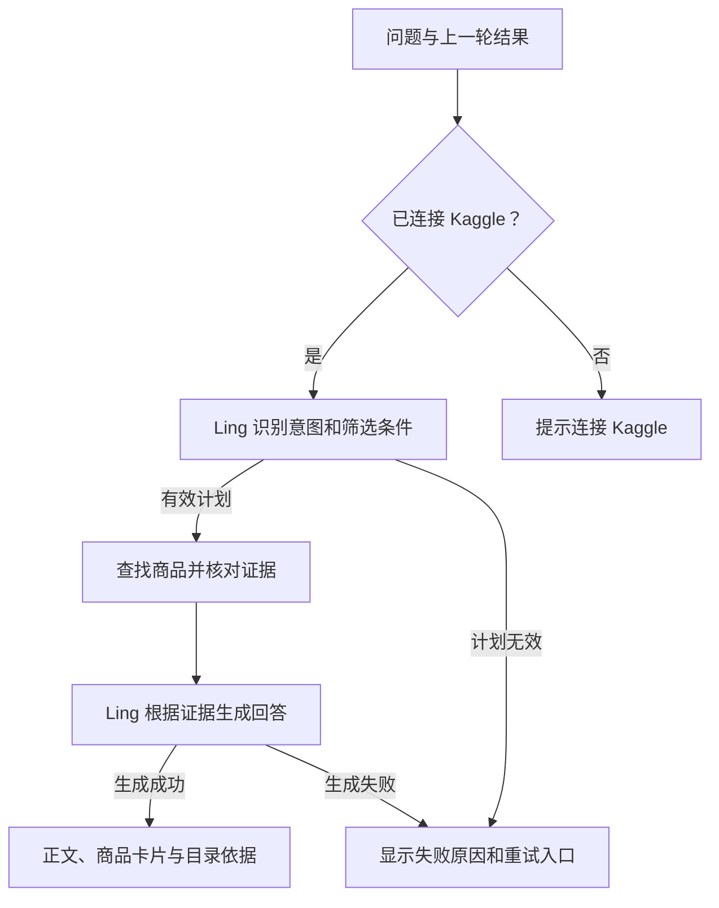
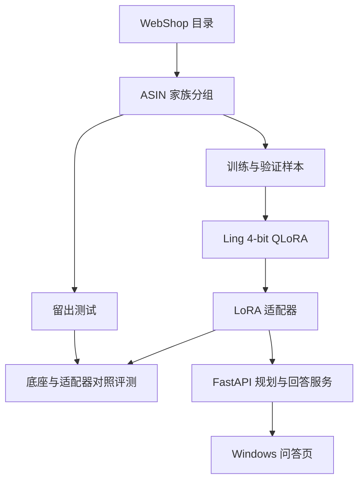

# 架构与运行流程

系统由浏览器目录和 Kaggle 上的 Ling 推理服务组成。模型读取问题与清单上下文，输出结构化任务。浏览器执行检索和证据核对，随后把目录证据交给模型生成回答。

## 问答执行

| 阶段 | 输入与输出 | 代码 |
|---|---|---|
| 规划 | 连接 Kaggle 后请求 Ling 生成计划。计划包括 `action`、任务、预算、尺码、颜色、型号、商品序号和术语约束。 | [规划协议](../web/policy.js) · [请求与状态](../web/app.js) |
| 校验 | Kaggle 校验规划输出，格式有误时尝试重新生成。浏览器校验收到的计划，请求失败时提示重试。 | [计划校验](../web/rag.js) · [推理接口](../training/serve.py) |
| 执行 | 搜索使用 BM25 与结构化条件筛选。详情和对比将提问里的位置映射回上一次结果列表的商品 ASIN。 | [检索和指代](../web/rag.js) |
| 核对 | 金额以美分计算。预算涉及明确尺码时优先使用对应选项价，缺价时标注所用的商品快照价。型号兼容性根据目录证据判断。 | [证据与推荐](../web/rag.js) |
| 呈现 | 模型根据核对后的目录证据写出正文，页面展示商品图片和目录依据。对话和失败记录可导出为 JSONL。 | [卡片和日志导出](../web/app.js) |

## 训练、评测与推理

- 训练读取 [JSONL 样本](../data/sft/) 与 [训练配置](../training/config.json)，以问题及上下文为输入、结构化计划为目标。训练写出适配器和逐步日志。
- [评测脚本](../training/evaluate.py) 在同一底座版本、提示和生成设置下比较关闭及启用适配器的结果。它分别保存逐题预测与聚合指标，方便核对任务识别和约束错误。
- [Kaggle 推理 Notebook](../kaggle/webshop-ling-inference.ipynb) 提供任务规划和回答生成。Windows 页面使用 Kaggle 会话地址连接服务，服务不可达时保留问题并提示重试。

如需重建问答样本，在项目根目录运行 `node scripts/prepare-dataset.cjs`。如需重新生成目录，将原始导出放到 `data/webshop-779.json`，再运行 `node scripts/prepare-catalog.cjs`。目录里的快照价无采集日期，242 件商品带有库存数量记录，60 件商品带有独立尺码价。

[训练与推理 Recipe](../RECIPE.md) · [运行日志](../LOGS.md)
