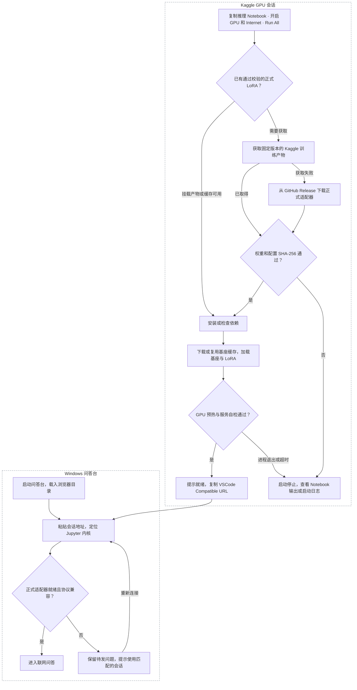
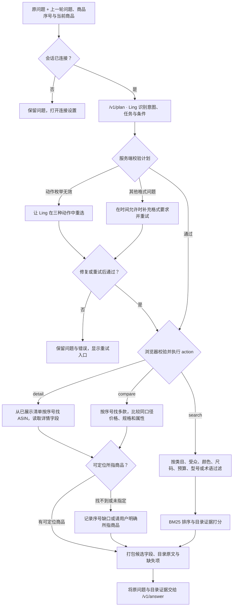
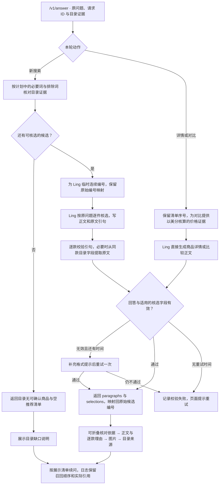
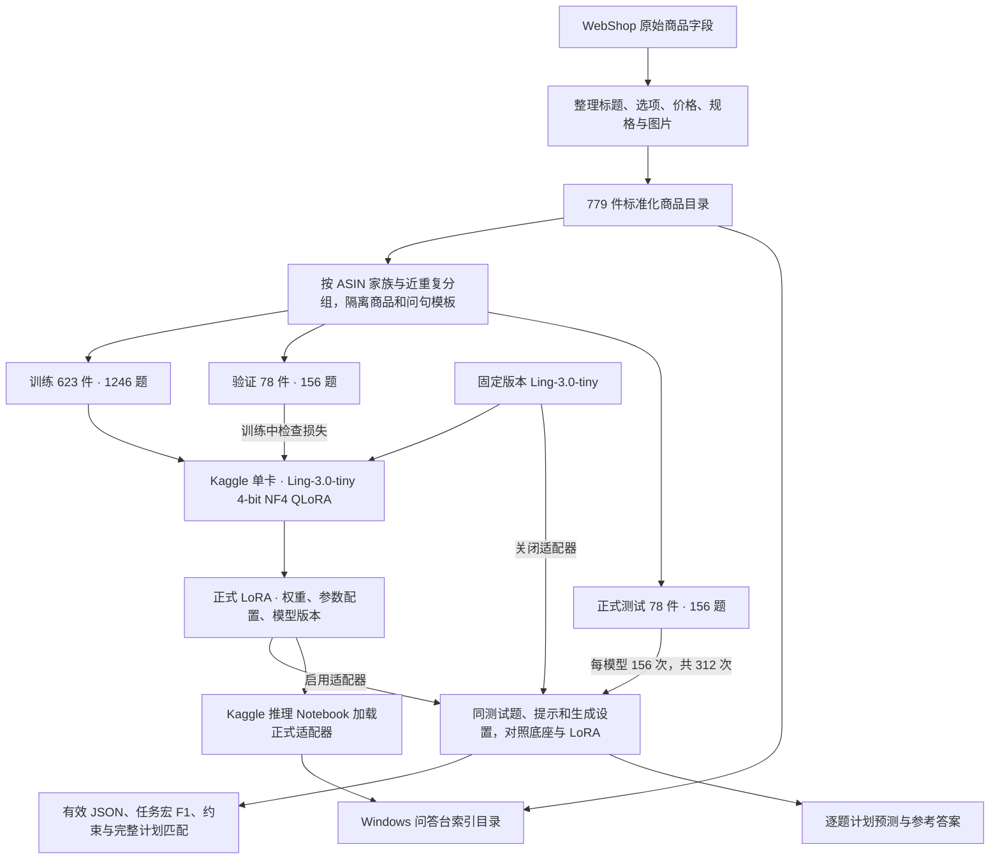

# WebShop RAG 项目架构图

Windows 问答台负责目录检索和展示。Kaggle 上的 Ling-3.0-tiny LoRA 负责理解问题、规划任务、核选商品与生成正文。下面按执行顺序展开连接、查询与回答，并给出正式训练和评测的复现入口。

[启动与连接](#启动与连接) · [问答执行](#问答执行) · [核选与回答](#核选与回答) · [训练、评测与推理](#训练评测与推理)

## 启动与连接

Windows 启动器经本地转发器连接 Kaggle Jupyter 通道，内核再访问会话内的 FastAPI。Notebook 自检会校验协议 4 和正式权重哈希，问答台检查服务已就绪、已启用正式适配器且支持所需协议。[转发器](../web/relay.cs) · [连接校验](../web/app.js) · [公开推理 Notebook](https://www.kaggle.com/code/aaronyue77/webshop-ling-inference)

## 问答执行

| 路由 | 执行方式与证据口径 |
|---|---|
| `search` | 从标准化目录召回候选。明确尺码优先用可核实的选项价，缺少选项价时标明所用商品快照价。型号兼容性按目录证据判断。 |
| `detail` | 使用上一轮展示编号定位商品。按需提供材质、颜色、尺码、规格和可核实的选项信息。 |
| `compare` | 按用户指定的序号定位商品。用同一价格口径核对差价，保留各款属性和缺失项。 |

目录的快照价没有采集日期。历史价格序列、实时库存和实时售价需要另有来源。若目录缺项，回答会说明可确认的信息和未知项。[规划字段](../web/policy.js) · [目录检索与指代](../web/rag.js) · [输入与回答格式](ANSWER-FORMAT.md)

## 核选与回答

连接、模型生成或输出校验失败会在问答台显示错误与重试入口。失败的查询仍会写入对话日志。[推理接口](../training/serve.py) · [网页呈现与对话导出](../web/app.js) · [日志口径](../LOGS.md)

## 训练、评测与推理

训练以问题和对话上下文为输入，以标准任务计划为目标。基座与 LoRA 共用同一套留出测试题。[训练与评测指南](../RECIPE.md)记录数据和复现命令。
